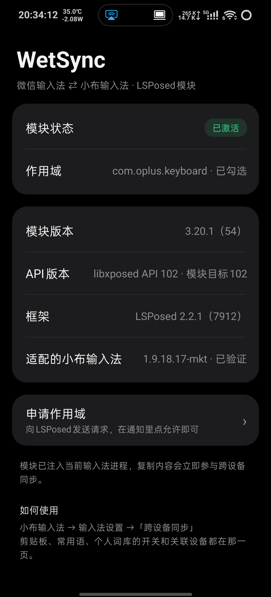

# WetSync · 微信输入法 ⇄ 小布输入法 跨设备同步


<p align="center">
  
</p>

<p align="center">
  <b>让 OPPO / 一加手机上换了输入法之后，依然能用微信输入法的跨设备同步。</b><br>
  LSPosed 模块 · 作用域仅 <code>com.oplus.keyboard</code> · 模块自带独立主页
</p>

---

## 它是什么

微信输入法（WeType）的跨设备同步在 PC 与手机之间体验很好，但把手机输入法换成小布输入法（`com.oplus.keyboard`）之后，这份能力就没了。

WetSync 是一个 LSPosed 模块：注入小布输入法进程，在它原生的设置页里挂上「跨设备同步」与「个人词库」入口，让小布输入法**以正常设备成员的身份加入微信输入法的设备组**，直接收发同步数据。

| 能力 | 方向 | 状态 |
|---|---|---|
| 剪贴板 · 纯文本 | PC ⇄ 手机 | ✅ 双向 |
| 剪贴板 · 图片 | PC ⇄ 手机 | ✅ 双向（COS 下载解密 / 上传发布） |
| 常用语（热词） | PC ⇄ 手机 | ✅ 双向 |
| 个人词库 | 微信 → 小布 | ✅ 单向增量 |
| 设备组关联 | 关联码（cmd30 / 31 / 32） | ✅ |

模块自己实现了微信输入法的接入协议（ECDH 握手 + protobuf + 签名），走 `wetype.weixin.qq.com/api_v2`，只依赖网络，本机不需要额外装别的客户端。

## 界面

模块主页是**模块自己的 App 页面**（桌面图标 `WetSync`），不往输入法里塞自绘界面：

<table>
<tr>
<td width="42%"></td>
<td>

**模块主页**（点桌面图标进入）

- 状态胶囊：`已激活` / `已授权` / `未授权` / `未检测到`（自动刷新，无需手动操作）
- 作用域：`com.oplus.keyboard`，是否已勾选
- 版本：模块版本、运行时 API、框架版本、适配的小布输入法版本（含「已验证 / 未验证」判定）
- 「申请作用域」直接向管理器发请求，通知里点允许即可，不打开管理器界面
- 底部固定提示入口：**小布输入法 → 输入法设置 →「跨设备同步」**
- 深色 / 浅色跟随系统，配色与 COUI 设置页一致

</td>
</tr>
</table>

同步开关本身留在输入法里：**小布输入法 → 设置 → 跨设备同步**（跨设备复制粘贴、常用语、个人词库、我的设备、关联设备）。这些行由模块注入宿主设置页，控件和交互完全复用宿主的 COUI 组件。

## 工作原理

```
PC 微信输入法  ⇄  wetype.weixin.qq.com  ⇄  小布输入法进程 (com.oplus.keyboard)
                    /api_v2                  └─ WetSync 模块
  cmd36 发布 / cmd34 拉取                      WtClient      轮询 · 收发 · 去重
                                               XiaobuInject  系统剪贴板读写
                                               XiaobuDictSync 词库合并导入
```

三条关键链路：

1. **入组**：ECDH(secp128r1) 交换 → AES-256-ECB 包裹请求 → `Kb-Sign` 签名 → 拿到 `server_key` 与
   `uin_token`，之后所有请求走同一条已签名的 `/api_v2` 通道。
2. **剪贴板**：本地 `ClipboardManager.setPrimaryClip` 被 hook → 内容有变即 `cmd36` 发布；
   对端更新则 `cmd34` 带回 `ClipboardMsg{version, type, data, from_uin}` → 写回系统剪贴板。
3. **词库**：`cmd42` 按 `msgId` 游标增量拉取 → 解析 `Entry` → 合并进宿主词库 JSON → 引擎重启。

细节见 [`docs/ARCHITECTURE.md`](docs/ARCHITECTURE.md) 与协议表 [`docs/PROTOCOL.md`](docs/PROTOCOL.md)。

## 兼容性

| 项 | 要求 |
|---|---|
| Android | 9.0+（`minSdk 28`），实测 ColorOS 17 / Android 17 |
| 框架 | LSPosed 2.1.x（`libxposed` API 102），需 Zygisk / KernelSU 环境 |
| 宿主 | 小布输入法 `com.oplus.keyboard`（实测 1.9.18.17-mkt） |
| 构建 | JDK 17+，Android SDK **Platform 37**（见下方构建说明） |

> 只在 ColorOS 17 的一加 13 上做过真机验证。其他机型理论上可用，但宿主设置页的类名与资源 id
> 随版本变化，菜单注入可能失效 —— 这类问题优先看日志里的 `settings_hook_*` 事件。

## 安装

1. 设备已 Root 并装好 **LSPosed 2.1.x**（Zygisk 或 KernelSU 均可）。
2. 安装 APK：从 [Releases](https://github.com/cxhuyo/WetSync/releases) 下载 `WetSync-v3.20.1.apk`；
   自行构建则用 `app/build/outputs/apk/release/app-release.apk`（两者内容一致）。
3. 在 LSPosed 管理器里**启用 WetSync**，作用域勾选 **`com.oplus.keyboard`**
   （只有启用过的模块才会拿到管理器服务通道）。
4. 打开桌面图标 **WetSync**；若作用域还没勾，点「申请作用域」→ 在通知里点允许，
   全程不需要打开管理器界面。
5. 强行停止小布输入法（或在 LSPosed 里点「重启应用」），下次弹出键盘时模块生效。
6. 回到模块主页，状态每 5 秒自动刷新，胶囊变成 `已激活` 即完成。

> 状态一直停在 `未检测到`，说明模块还没在管理器里启用 —— 启用后本页会自动更新，
> 不需要手动刷新。

## 首次使用

模块首次运行会**自动注册一个匿名设备身份**（不需要微信账号，也不改动 PC 端任何配置），
之后在输入法里完成一次设备关联即可：

1. 随便点开一个输入框，让小布输入法跑起来（模块主页显示 `已激活`）；
2. **PC 端微信输入法** → 设备管理 → 生成 6 位关联码；
3. **小布输入法** → 设置 → 跨设备同步 → 关联设备 → 输入这 6 位码；
4. 也可以在手机上点「查看匹配码」出码，再到 PC 端输入，方向随意；
5. 关联成功后，同一设备组内的剪贴板、常用语、个人词库开始同步。

「跨设备同步」页里可以随时查看：

- 剪贴板同步 / 常用语同步开关（对应服务端功能位）
- 同步个人词库开关 + 立即同步
- 设备组成员列表、本机身份
- 关联码（本机出码 / 输入对端码）

凭证与运行时状态写入宿主私有目录 `/data/data/com.oplus.keyboard/files/wtsync/`。

## 构建

```bash
git clone <your-repo-url> WetSync && cd WetSync

# 需要 JDK 17+；AGP 8.7.3 + Gradle 8.13
export JAVA_HOME=/path/to/jdk17
export ANDROID_HOME=/path/to/AndroidSdk

./gradlew :app:assembleRelease
# 产物：app/build/outputs/apk/release/app-release.apk
```

两个必须注意的点：

1. **`compileSdk` 必须是 37**。`libxposed:api:102.0.0` 的 AAR 清单声明
   `minCompiledSdkVersion=37`，用 35/36 会直接编译失败。
2. **签名**。仓库默认用 debug 签名（`assembleRelease` 可直接安装）。要换成自己的签名，
   在仓库根目录放 `keystore.properties`（已被 `.gitignore` 排除）：

   ```properties
   storeFile=release.jks
   storePassword=******
   keyAlias=wetsync
   keyPassword=******
   ```

更多（SDK 37 安装、常见报错、真机部署）见 [`docs/BUILD.md`](docs/BUILD.md)。

## 目录结构

```
WetSync/
├── app/
│   ├── build.gradle                     # 版本号 / 签名 / compileSdk 37
│   └── src/main/
│       ├── AndroidManifest.xml          # 模块主页 Activity + 包可见性
│       ├── java/com/cxhuyo/wetsync/     # 22 个源文件，见下表
│       └── resources/META-INF/xposed/   # module.prop / scope.list / java_init.list
├── docs/
│   ├── ARCHITECTURE.md                  # 模块架构与数据流
│   ├── PROTOCOL.md                      # 微信输入法子命令与字段表
│   ├── BUILD.md                         # 构建、签名、部署
│   ├── LSPOSED_STATUS.md                # 模块状态检测与作用域申请（libxposed service）
│   ├── TROUBLESHOOTING.md               # 息屏不同步 / 面板缺行 / 回声 等
│   ├── clipboard-image-sync.md          # 图片剪贴板专题（逆向分析）
│   └── DEVLOG.md                        # 逐版本开发日志（含踩坑记录）
├── tools/                               # 辅助脚本（图标生成、dex 静态分析）
├── gradle/wrapper/                      # Gradle 8.13 wrapper
├── build.gradle · settings.gradle · gradle.properties
└── LICENSE                              # GPL-3.0
```

### 源码职责

| 文件 | 职责 |
|---|---|
| `MainHook` | 模块入口：`onModuleLoaded` / `onPackageReady`，安装 hook、启动引擎、PROBE 广播 |
| `StatusActivity` | 模块主页：状态胶囊、作用域查询/申请、版本信息，5 秒自动刷新 |
| `FrameworkStatus` | libxposed service 单例：框架/API/作用域/注入进程，作用域状态持久化 |
| `WetSyncApp` | Application：尽早注册 service 监听，binder 到达即回调 |
| `XiaobuSettingsHook` | 宿主设置页注入「跨设备同步」与「个人词库」入口 |
| `SyncPage` | 跨设备同步页（开关、设备列表、关联码），复用宿主 COUI 组件 |
| `UserDictPage` | 个人词库全屏列表页（搜索、编辑、新增、软删除） |
| `WtClient` | 同步引擎：轮询、收发、去重与回声抑制、词库与常用语调度 |
| `WxClient` | 协议客户端：握手、子命令、protobuf 编解码 |
| `WtCrypto` | 纯 Java secp128r1 ECDH + AES-256-ECB + SHA256 |
| `HttpChannel` / `DnsUdp` / `Snappy` | 极简 HTTPS、DNS、Snappy 解压（零第三方运行时依赖） |
| `XiaobuInject` | 系统剪贴板读写，带防回环标记与幂等闸门 |
| `XiaobuClipDb` | 宿主剪贴板历史表的补录与裁剪（直接 SQLite，仅 INSERT/DELETE） |
| `XiaobuDictSync` / `WxDictReader` | 微信词条解析、与小布词库 JSON 的合并导入 |
| `XiaobuPhraseStore` | 常用语读写（宿主 API 封装） |
| `ClipImageCodec` / `ClipImageStore` | 图片压缩、AES-CTR 加解密、媒体库托管 |
| `MainHookLogger` | 统一日志（logcat + 落盘） |
| `DictDiag` | 诊断命令分发（`clipdb|stat`、`catchup` 等，需手动开启） |

## 已知限制

- **首次历史词库拿不到**：服务端增量窗口有限，旧 `msgId` 会被拒；全量快照需要
  `ApplyCosTokenReqV2` 的预签名 URL，该子命令尚未定位。日常增量同步不受影响。
- **小布 → 微信 词库方向未实现**：宿主只有 `resetUserDict`（清空），写入需要 COS 上传凭证。
- 超过 256 KiB 的文本只走内联，不走 COS 上传。
- 输入法进程被系统冻结时（键盘收起 + 息屏），写剪贴板会被 `WRITE_CLIPBOARD` 的
  foreground 语义拒绝；模块用「待写队列 + 键盘亮起补写」兜底，极端情况下可能延迟到下次弹键盘。
- CDN 偶发短时限流（约 1 分钟自愈），已做 4 IP 故障转移与失败重握手。
- 模块主页的「已激活」需要小布输入法进程在跑；键盘收起且进程被回收时显示
  `已授权`，弹出一次键盘，本页会自动更新为 `已激活`。

## 数据与隐私

- 作用域只有 `com.oplus.keyboard`，模块只在输入法进程内运行。
- 凭证与运行时状态全部落在宿主私有目录 `files/wtsync/`，仅本机可读。
- 仓库内**不含**任何真实账号、token、设备组 id、内网地址；示例一律用占位符。
- 日志默认写到 `files/wtsync/module.log`，可在设置页关闭诊断后不再产生。

## 参与贡献

见 [`CONTRIBUTING.md`](CONTRIBUTING.md)。提 issue 时请附上：

```
机型 / 系统版本 / 小布输入法版本 / LSPosed 版本
module.log 中相关片段（自行脱敏 uin、设备名、token）
```

## 许可

[GPL-3.0](LICENSE)。本项目与腾讯、OPPO 均无关联，为个人逆向学习与自用工具，
按原样提供、不含任何担保。
